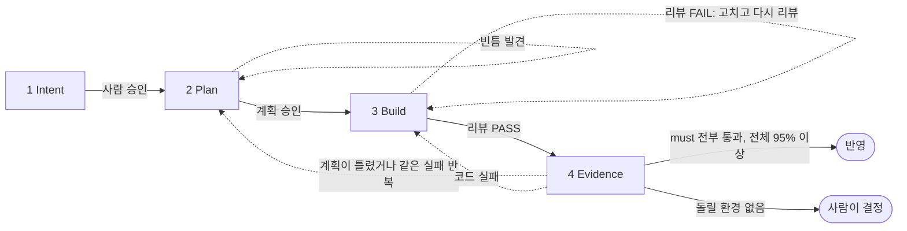

<div align="center">

# sdlc-kit

### 코딩 에이전트가 제 숙제를 스스로 채점하지 않게 합니다.

**어떤 코드베이스, 어떤 도메인에서든 쓰는 AI 코딩 에이전트용 4단계 SDLC.**

Intent → Plan → Build → Evidence. 코드를 쓰기 전에는 여러 탐색 에이전트를 나란히 돌려 조사하고, 코드를 쓴 뒤에는 따로 띄운 리뷰어가 공격적으로 검토하며, 마지막에는 점수를 매겨 다음 단계를 정합니다.

[](https://github.com/cskwork/sdlc-kit/releases/latest)
[](https://cskwork.github.io/sdlc-kit/)

[**사이트 보기**](https://cskwork.github.io/sdlc-kit/) · [**빠른 시작**](#빠른-시작) · [**계약 문서**](SKILL.md) · [**English**](README.md)

</div>

---

코드는 이제 빨리 나옵니다. **틀렸을 때 드는 비용은 여전히 큽니다.** 코드부터
쓰는 에이전트는 부작용을 가장 늦게 발견하고, 자기 작업을 자기가 검사하는
에이전트는 문제를 잘 찾지 못합니다. sdlc-kit은 이해를 맨 앞에, 독립된 증명을
맨 뒤에 두고, 그 사이는 작게 유지합니다.

[Anthropic의 AI-Native SDLC playbook](https://claude.com/blog/the-ai-native-sdlc-playbook)을
바탕으로 했고, 특정 하네스가 필요 없습니다. 핵심 루프는 Markdown 파일과 셸 스크립트
하나로 되어 있습니다. 개인 to-do는 Node 18+가 필요한 선택 기능입니다.

> sdlc-kit은 독립 프로젝트이며 Anthropic과 관계가 없습니다.

## 루프



| 단계 | 하는 일 | 되돌아가는 때 |
|---|---|---|
| **1 Intent** | 요청한 것, 에이전트가 이해한 것, 그 이해에 숨은 위험을 적고, 여섯 영역으로 명확도를 매깁니다. 90%에 못 미치면 에이전트가 코드를 살피고, 버그를 재현하고, 스펙을 조사하거나, 티켓·이슈·PR에서 요청자에게 묻습니다. 맨 위 세 줄 요약(At a glance)으로 시작하고 에이전트용 근거는 맨 아래에 둡니다. 각 제목의 뜻은 아래 표에 있습니다. 사람은 "이게 원하는 것인가?"에 답해 승인합니다. | — |
| **2 Plan** | 여러 scout가 나란히 정본·데이터·로직·사용자 흐름을 조사해 `refs/`에 남깁니다. `PLAN.md` 한 장에 AS-IS → TO-BE, 부작용, QA가 돌릴 시나리오를 담습니다. | 누락 점검에서 빈틈이 나올 때 |
| **3 Build** | 가장 작은 완전한 변경을 만들어 커밋하고, 별도 리뷰어가 공격적으로 검토합니다. | 리뷰 FAIL: 고치고 다시 리뷰 |
| **4 Evidence** | 실제 검사 뒤, 모든 시나리오를 각 페르소나로 실제 인터페이스에서 돌립니다. 점수와 다음 경로는 에이전트가 아니라 `sdlc.sh score`가 정합니다. | 계획이 틀렸거나 같은 실패 반복 → Plan, 코드 실패 → Build |

### intent.md 제목 읽는 법

제목과 항목 이름은 영어로 두고 본문은 요청한 사람의 언어로 씁니다.

| 제목·항목 | 뜻 |
|---|---|
| **At a glance** — What changes · Not included · Your call | 한눈에 보기: 끝나면 무엇이 바뀌는지, 빠지는 것 중 가장 큰 것, 사람이 정해야 할 것 |
| **What was asked** | 요청 원문 또는 충실한 발췌 |
| **Why this came up** | 요청이 생긴 배경(이력). 요청·티켓·스레드에 이유가 있으면 인용하고, 없으면 티켓 이력·연결 이슈·커밋·memory로 추정해 줄 앞에 `(추정)`과 근거를 붙입니다. 추정을 사실처럼 쓰지 않습니다. |
| **What we will do** — Included · Not included · Done when | 이번에 할 일, 하지 않을 일(이유 포함), 끝났다고 볼 기준 `O1..On`(눈으로 확인 가능) |
| **Risks** | 이 요청에 숨은 위험. ⚠️는 사람의 권한이 필요한 것 |
| **Shipping** — Ship to · Note · Allowed | 어디까지 반영할지(`local`·`pr`·`deploy`), 부가 설명, 사람이 허락했는지 |
| **Questions for you** | 답이 없으면 승인할 수 없는 질문. 답하면 `— resolved:`가 붙습니다 |
| **Key terms** | 요청을 좌우하는 용어와 그 뜻 |
| **How sure we are** — Goal · Boundaries · Today · After · Done when · Limits | 확신 정도: 목표, 범위 경계, 지금 동작, 바뀐 뒤 동작, 완료 기준, 제약을 `clear`·`assumed`·`open`으로 매기고 90%가 넘어야 승인 |
| **Facts** | 위 판단의 근거 `F1..`와 출처 |

v2.13.0까지의 제목(Bottom line, Understood as, Clarity, Delivery 등)으로 쓴 intent.md도 `sdlc.sh`가 그대로 읽습니다.

되돌아가는 횟수는 리뷰 FAIL, Plan 복귀, Build 복귀마다 세 번까지입니다. 넘으면
루프가 멈추고 사람이 정하며, `sdlc.sh approve plan --human`으로만 다시 시작합니다.
못 돌린 시나리오는 실패로 칩니다. 시나리오를 지우는 것은 사람만 할 수 있고,
PASS에는 반드시 로그가 붙어야 합니다.

## 빠른 시작

```bash
# 1. 한 번 설치하고, 에이전트가 스킬을 찾는 폴더에 연결
git clone https://github.com/cskwork/sdlc-kit ~/sdlc-kit
ln -s ~/sdlc-kit ~/.claude/skills/sdlc-kit      # Claude Code 기준, 하네스마다 스킬 폴더가 다름

# 2. 프로젝트(또는 모노레포의 배포 단위)에 씨앗 심기
cd /path/to/your-project
~/sdlc-kit/sdlc.sh init
$EDITOR .sdlc/config.md                          # build, test, lint, run, e2e, qa
```

스킬 폴더가 없는 하네스라면 지침 파일(`AGENTS.md`, `CLAUDE.md`, `GEMINI.md`)에
`For SDLC work, read ~/sdlc-kit/SKILL.md and follow it.`을 넣으세요. 그다음
"CSV 내보내기 추가", "로그인 리다이렉트 고쳐 줘"처럼 평소 말로 요청하면 에이전트가
루프를 돕니다. 다음에 할 일은 언제든 `sdlc.sh next <slug>`가 알려 줍니다.

## 기능 하나가 남기는 것

```
.sdlc/work/<slug>/
  intent.md     요청과 그 배경, 할 일, 위험, 확신 정도
  refs/         scout 결과와 intent 점검: source.md data.md logic.md flow.md learnings.md intent-check.md
  PLAN.md       한 장: 이해, AS-IS → TO-BE, 부작용, 변경, 시나리오
  review.md     리뷰 라운드, 각 라운드는 VERDICT로 끝남
  evidence.md   검사, 시나리오별 결과 한 행, 반영 기록
  logs/         모든 PASS·FAIL 뒤의 원본 출력, scripts/는 시나리오별 재실행 스크립트
```

끝난 기능은 `.sdlc/archive/`로 옮겨지고, `logs/` 아래 다시 만들 수 있는 캐시
(`gradle-home`, `node_modules`, `build` 등, config.md `prune:`)는 지웁니다.
검증된 사실은 `memory` 폴더로 옮깁니다. 코드에서 싸게 알 수 없는, 다시 쓸 사실·규칙·함정만
둡니다. 사실 한 줄은 근거와 날짜로 끝납니다(`[verified: <경로> @ <sha> | as-of: <날짜>]`,
`[source: <slug 또는 대화 기록> | as-of: <날짜>]`, `[unconfirmed]`). 에이전트는 close 때만이
아니라, 그런 것을 검증하거나 함정에 빠진 그 순간에 페이지를 씁니다. `INDEX.md` 맨 위의
`## Core`는 사람이 관리하는 칸으로, 모든 에이전트에게 필요한 규칙 몇 개만 한 줄과 링크로
둡니다(25줄, `memory_core_kb` 이하). 그 아래는 페이지마다 한 줄인 생성 목록입니다(`sdlc.sh memory
index`가 다시 만들고 `close`가 갱신). 색인은 없는 파일을 가리키는 링크, `MOVED TO` 껍데기 페이지,
근거 표시 없는 페이지, `memory_page_kb`를 넘는 페이지, `## Current picture` 없이 8,000바이트를
넘는 페이지도 셉니다. 에이전트는 색인부터 읽고 그 색인이 가리키는 페이지만 열며, 항목이 없으면
memory를 grep합니다. `close <slug> shipped`에는 evidence.md Shipping의 `Memory:` 줄(고친 페이지,
또는 `none — <이유>`)이 필요합니다. 그 안의 `glossary.md`가 프로젝트 용어집입니다. Intent는
요청의 용어를 여기에 대조하고, Evidence는 기능에서 확정한 용어를 여기에 더합니다.

`sdlc.sh dream --check`는 마지막 정리 뒤 기능 3개가 닫혔거나(shipped·dropped 모두), 하나 이상
닫힌 채 14일이 지나면 10으로 끝나고(닫힌 것이 없으면 하지 않음, 예: `due: 3/3 closes since <시각>`),
`sdlc.sh dream`은 새 에이전트에게 줄 지시(`roles/dreamer.md`)를 출력할 뿐 아무것도 기록하지
않습니다. 그 에이전트는 memory를 HEAD 코드와, 세션에서 일어난 일은 그 기능의 대화 기록과 `logs/`와
대조해 낡은 내용을 고치거나(대체됨·충돌 표시) 지우고, 중복을 합치고, 여러 세션에서 되풀이된 실수를
규칙으로 만들고, `## Core` 규칙을 올리고 내리고, 닫힌 기능에서 쓸 사실을 거두고, 크기 예산을
지킵니다. 마지막 단계 `sdlc.sh dream --done [--through <시각>] [--note <메모>]`가 `.dream-state`에
기록합니다(지시문이 `--through` 시각을 알려 주므로 그 뒤에 닫힌 기능은 다음 정리 대상으로 남음).
dreamer가 `.dream-log.md`를 쓰지 않았으면 한 줄을 더합니다. 일정 실행기가 dreamer를 띄우지
못해도 정리 차례를 잃지 않습니다.

대화 기록(transcript)은 dream이 메모를 대조하는 세션 원본입니다. `transcripts:`에 셸 명령을 두면
프로젝트 루트에서 `{slug}`와 `{since}`(마지막 정리 UTC 시각)를 바꿔 실행하고, 그 기능의 대화
기록·로그 경로나 `경로:줄` 위치를 출력하게 합니다. 예: `transcripts: grep -rln {slug} ~/agent-sessions`.
지시문에는 기능마다 `transcripts_max`개까지 `경로` 또는 `경로:줄`만 실리고(본문은 싣지 않음),
dreamer는 파일 전체를 읽지 않고 grep합니다.

지식은 종류마다 집이 하나입니다. 프로젝트 지식은 memory 폴더가 집이고, 따로 쓰는 다른 메모 저장소
(비서의 개인 메모, 다른 노트 시스템)는 사용자 선호·피드백이나 원본 기록처럼 제 종류만 둡니다. 그런
저장소를 `peers:`에 적습니다(공백이나 쉼표로 구분, `~`와 glob 허용, 상대 경로는 프로젝트 루트 기준).
지시문에는 저장소마다 파일 수와 크기만 실리고(본문은 싣지 않음), dreamer는 손대는 사실을 그곳에서
grep하되 고치지 않으며, 중복이나 모순은 `peer: <peer 파일> duplicates|contradicts <memory 페이지> —
propose: keep in <페이지>, remove from peer` 줄로 보고해 사람이 처리하게 합니다. 한꺼번에 옮기지 않습니다.

config.md에 선택해 넣을 키와 기본값: `transcripts:`·`peers:`(비우면 없음), `transcripts_max: 20`,
`memory_core_kb: 2`, `memory_page_kb: 16`, `memory_top_kb: 64`, `memory_total_kb: 256`(색인 경고),
`dream_every: 3`, `dream_max_days: 14`, `stages:`(비우면 한 번에 반영, 아래 단계별 반영), `prune: gradle-home .gradle node_modules build .m2 target`(비우면
지우지 않음), `archive_warn_mb: 50`.

## 설정

프로젝트마다 다른 값은 `.sdlc/config.md` 한 곳에만 둡니다. `build`, `test`,
`lint`, `run`, `e2e` 명령, 화면이나 API를 다룰 `qa` 도구, 선택 실행기 어댑터 `qa_runner`와
그 로그인 명령 `qa_session`, `human_gates`(기본값
`intent`, 모든 plan을 직접 승인하려면 `plan` 추가, 위험 플래그가 있는 plan은
설정과 상관없이 사람이 승인), `memory` 폴더, `repos`(리뷰가 묶을 저장소.
프로젝트 루트 아래 저장소가 많으면 나열하거나 리뷰마다 `sdlc.sh review <slug> pass --repos "<경로> ..." "<메모>"`로 지정하고, 비우면 루트 아래 전부)입니다. `.sdlc/`는
`.git/info/exclude`로 git에서 빠집니다. 팀이 배운 것을 공유하려면 `memory:`를
git이 추적하는 폴더로 지정하세요.

`adapters/e2e/`가 그런 실행기 하나입니다. `qa_runner: e2e`이면 QA는 브라우저·모바일
시나리오마다 [e2e](https://www.npmjs.com/package/e2e) 테스트를 씁니다. 결정적 층(증거,
모델 없음)과, 다음 라운드부터 모델 호출 없이 재생되는 선택 agent 층으로 나뉩니다.
키트는 e2e의 에이전트 가이드를 버전 고정으로 들고 있어(Apache-2.0) 오프라인에서도
쓸 수 있고, `adapters/e2e/update.sh [버전]`으로 갱신합니다.

## 단계별 반영

dev, 다음 staging, 다음 운영처럼 며칠에 걸쳐 반영하는 프로젝트는 config.md에 단계를 순서대로
적습니다: `stages: dev, stg, prd`. deliver 경로에서 `next`가 다음 단계를 알려 주고, 반영한
단계마다 다음 명령으로 기록합니다.

```bash
sdlc.sh ship <slug> <stage> <sha> [repo] --checked "<명령>" --output "<판정 출력 줄>"
```

`close shipped`처럼 지금 증거의 deliver 경로, 유효한 evidence, 대상에 대한 허락이 필요하고,
`local`이 아니면 `<sha>`가 원격에 있어야 합니다. `<sha>`는 검증한 `Commit:`과 트리가 같거나(`exact`)
그 커밋을 품어야 합니다(`contains`: 다른 변경과 함께 브랜치로 올린 `--no-ff` 머지). 그 커밋 자체의
변경(첫 부모 기준)이 앞뒤 문맥 줄 없이(`git apply -C0`, 바뀐 줄이 모두 남아 있는지) 그 sha 위에서 거꾸로
적용되면 `contains`입니다. 뒤의 다른 변경이 그 줄을 고쳤다면(다른 티켓이 이 티켓이 만든 파일을 고친 경우) `contains-edited`로
기록하고, 그 사이의 `git revert`가 이 커밋이나 이 커밋을 들여온 머지를 되돌렸을 때만 거부합니다(손으로 되돌린 것은 `contains-edited`로 보입니다). 기록, 출력,
`status --json`의 `stages[].match`가 어느 쪽인지 보여 줍니다. `close`의 `Shipped:` 줄은 여전히
트리가 같아야 합니다. 모르는 단계, 이미 기록한 단계, 앞 단계가 기록되지 않은 단계는 거부합니다. 단계는 채점한
증거와 그 build 차수에 묶인 `stage:` 줄로 `.state`에 한 번만 기록되고(`events.log`에는 명령과
출력이 남음), 다시 채점하거나 plan을 다시 승인하면 처음 단계부터 다시 기록합니다. 기록은 반영한 git
저장소 단위이고, 저장소는 모든 worktree와 본 checkout이 함께 쓰는 git common dir로 알아봅니다. 그래서
한 저장소의 두 폴더를 가리키는 `Commit:` 줄은 기록을 함께 쓰고, 임시 worktree에서 만든 `Commit:`은
본 checkout에서 반영할 수 있습니다. `score`가 `Commit:` 줄마다 저장소를 `.state`에 적어 두므로
worktree를 지운 뒤에도 `ship`, `next`, `close`가 동작하고, `close`는 그 저장소의 남은 폴더에서
`Shipped:` 줄을 확인하며 남은 폴더가 없으면 그렇다고 알립니다. `check ship`은 프로젝트 루트나 `Shipped:` 줄의 같은 저장소
checkout에서 커밋을 확인하고, 커밋 객체가 없으면(브랜치 삭제 후 정리, shallow clone) 그렇다고 알립니다. 저장소 identity는 `git rev-parse --path-format=absolute`(git 2.31 이상)로 읽고, 그보다 오래된 git에서는
상대 common dir로 대신합니다. 단계 이름은 영문자·숫자·`.`·`_`·`-`이고 한 번씩만,
쉼표나 공백으로 나눠 적으며 빈 항목이나 같은 줄의 `#` 주석은 허용하지 않습니다. `ship`에는 `Commit:` 줄이
가리키는 폴더를(그 checkout이든 같은 저장소의 다른 checkout이든) 주고, 그 저장소의 `Commit:` 줄은
모두 `<sha>`와 맞아야 합니다. `status`와 `next`는 `deliver READY · at stg (2/3)`처럼
보여 주고, `status --json`에는 `stage`와 `stages`가 붙습니다. 그 뒤 `close <slug> shipped`는
모든 `Commit:` 저장소가 마지막 단계에 닿아야 하고, 마지막 단계가 에이전트 손 밖이면
`close <slug> shipped --at <stage> "<이유>"`로 기록된 단계를 지정합니다. 이유와 단계는 닫힘
메모와 이벤트에 남습니다. `stages:`가 없으면 아무것도 바뀌지 않고 `ship`과 `--at`은 거부됩니다.

위험 플래그가 yes인 plan은 Risk flags 아래에 되돌리는 방법도 적습니다:
`- Undo: flag <name> | revert <what> | config <key> | none — <why>`. 없으면 `approve plan`이
거부하고 `next`는 고칠 차례를 에이전트에게 넘깁니다. 플래그가 모두 `no`인 plan에는 필요 없고, 이
규칙 전에 승인된 plan은 승인이 유지됩니다. Undo가 플래그를 가리키면 Shipping의
`Policy:` 줄에 그 플래그를 지우는 후속 작업을 적습니다.

## 늘 지키는 규칙

- **권한은 게이트와 별개입니다.** 데이터 유실, 마이그레이션, 공개 API 변경,
  보안에 민감한 코드, 인프라 변경, push·merge·배포, 티켓에 다는 댓글은 어떤
  설정에서든 사람이 미리 허락해야 합니다.
- **독립된 눈.** scout, 리뷰어, QA는 작업을 만든 컨텍스트가 아닌 새 컨텍스트에서
  돕니다.
- **주장 대신 증거.** 실행 환경이 없으면 PASS가 아니라 BLOCKED입니다. 버그 수정에는
  수정 전에 실패한 테스트가 있어야 하고, 새 동작의 테스트는 그 동작 없이 한 번
  실패하는 것을 확인합니다.
- **검증한 것만 반영.** push·merge·배포 전에 `sdlc.sh check ship <slug>`를 돌립니다.
  지금 증거로 deliver 경로가 나왔고, QA가 검증한 커밋이 체크아웃되어 있고, 대상에 대한
  허락이 있을 때만 `GATE OPEN`을 출력합니다. 반영한 트리가 검증한 커밋과 다르면
  `close`가 거부합니다.

Build는 [ponytail](https://github.com/DietrichGebert/ponytail) 방식(가장 작은
완전한 변경)을 따릅니다. 규칙은 단계 문서에 들어 있어서 다른 스킬이 필요 없습니다.

## 호스트에서 돌리기

`sdlc.sh status --json`은 모든 기능의 단계, 상태, 점수, 경로와 `ageDays`(첫 이벤트와 폴더를 만든 때
중 이른 쪽부터), `lastEventAt`, `stage`, `stages`를 보여 줍니다.
`sdlc.sh stats [--json] [--since YYYY-MM-DD]`는 열린·보관된 기능의 `events.log`(상태가 바뀔 때마다
UTC 시각, 명령, 바뀐 뒤 단계, 결과, 내용을 한 줄씩 덧붙이는 기록)를 모아 단계·상태별 수, 단계별
소요 시간 중앙값과 p90, 채점 횟수, plan·build 복귀, BLOCKED 이유 상위, 주별 닫힘 수를 보여 줍니다.
`events.log`가 없는 기능은 legacy로, 기록이 `new`로 시작하지 않는 기능(기록을 시작할 때 이미
진행 중이던 것)은 partial로 세고 둘 다 시간 계산에서 뺍니다. `events.log` 덧붙이기가 실패하면
경고만 하고 명령은 그대로 끝납니다.
`sdlc.sh next <slug>`는 `0` 진행 가능, `10` 사람 필요, `20` 막힘, `30` 완료로
끝납니다. 스크립트는 기록하고 보고할 뿐 모델을 돌리지 않습니다. 무인 실행은
기록된 사람의 허락만큼만 반영합니다. 따로 허락하지 않았다면 로컬 커밋까지입니다.
Windows에서는 Git Bash나 WSL로 `sdlc.sh`를 실행하세요.

## 개인 to-do

여러 프로젝트의 할 일을 사람이 읽을 수 있는 `~/.sdlc/todo.md` 하나에 모읍니다.
트레이 배지, TUI, localhost 웹 페이지(기본은 보드, 목록은 버튼 하나로 전환)는 같은 파일을 실시간으로 보여 주고 고칩니다.
다른 파일을 쓰려면 `SDLC_TODO`를 지정하세요.
이 선택 기능에는 Node 18+가 필요하고, 핵심 루프는 여전히 bash만 있으면 됩니다.

```bash
cargo build --release --manifest-path ~/sdlc-kit/todo/app/Cargo.toml   # 앱을 쓸 때 한 번 (Rust 1.88+)
SDLC_TODO_LANG=ko bash ~/sdlc-kit/todo/app/install-macos.sh            # macOS: ~/Applications에도 추가
node ~/sdlc-kit/todo/todo.mjs                     # 앱: 보드를 여는 트레이 배지 (앱을 빌드하지 않았으면 웹 링크가 있는 TUI)
node ~/sdlc-kit/todo/todo.mjs --ui tui,web        # tui, web, app 중 원하는 것
node ~/sdlc-kit/todo/todo.mjs web --open          # 웹 페이지만 열기 (보드)
node ~/sdlc-kit/todo/todo.mjs add "Fix login ~/code/web https://acme.atlassian.net/browse/WEB-123" --by jira
node ~/sdlc-kit/todo/todo.mjs next                # 첫 Open 항목
node ~/sdlc-kit/todo/todo.mjs take <id> --json    # 작업자가 맡은 항목 하나와 그 답
```

웹 페이지는 **보드**로 열리고, 보드에서 바로 답하고 승인합니다.
열은 sdlc 단계입니다. 일반(sdlc 작업이 없는 항목, 있을 때만 보임), 의도, 계획, 구현, 검증, 배포, 그리고 최근 7일 완료(접혀 있음) 순이고, 이전 형식(`legacy`) 항목은 아래 접힌 상자에 있습니다.
행은 다른 화면과 같은 상태로 누구 차례인지 나눕니다. 내 차례, 다른 사람 답 대기, 막힘·환경 대기, 에이전트 차례이며, 에이전트가 작업 중인 카드에는 깜박이는 점이 붙습니다.
같은 티켓 링크를 가진 열린 항목은 카드 하나로 합칩니다. 14일 넘게 변화가 없는 카드는 토글 뒤에 숨기며, 내 차례·막힘·고정 카드는 숨기지 않습니다.
위쪽 띠에는 건수, 피드 상태와 알림, 마지막 업데이트, 언어 메뉴, 보기 전환 [보드] [목록] [실행] [건강]이 있고, [실행]과 [건강]은 피드가 있을 때만 보입니다.
화면 폭이 약 900px보다 좁으면 목록을 보여 주며, [목록] 보기는 이전 페이지의 기능을 모두 그대로 둡니다.

카드를 누르면 결정 패널이 열립니다. 질문, 권장 선택지의 **AI 권장** 배지, 브리프의 배경과 이유, 선택지 버튼, 직접 답하기 칸, 의도·계획 승인(같은 SHA 묶음 `/api/approve`), 막힌 항목의 자가 조치가 보입니다.
선택지는 목록과 같은 보통 답변을 보내고, 카드 안에서 내 차례인 항목으로 갑니다.
"내 차례 n/N"은 ←/→ 또는 j/k로 내 카드를 넘기고, Esc로 패널을 닫습니다. 요청 중에는 버튼이 잠기고, 끝나면 토스트로 알리며, 실패하면 이유를 패널에 보여 줍니다.
**티켓 열기**는 링크를 탭이 아닌 화면 왼쪽 가장자리에 붙은 팝업 창 하나로 열어, 오른쪽에 그대로 있는 결정 패널과 함께 보며 정할 수 있게 하고, 다른 카드로 넘어가면 같은 창을 그 티켓으로 바꿉니다. Jira 같은 티켓 사이트는 iframe을 거부(X-Frame-Options)하므로 팝업을 씁니다.
직접 답하기 칸에서 Enter는 답을 보내고 Shift+Enter는 줄을 바꿉니다. 한글을 조합하는 중의 Enter로는 보내지 않습니다. 목록의 답변 칸도 같습니다.
모든 버튼에는 마우스를 올리거나 키보드로 옮기면 하는 일과 단축키를 알려 주는 툴팁이 뜹니다(예: "티켓 열기 (T)"). 위쪽 띠의 [단축키]나 `?`로 아래 표를 엽니다. 한 글자 키는 입력 칸 밖에서만 작동합니다.

| 키 | 하는 일 |
|----|---------|
| ←/→, j/k | 이전·다음 내 카드 |
| 1–9 | 그 번호의 선택지 답 보내기 |
| R | 답 입력 칸으로 이동 |
| Enter / Shift+Enter | 입력 칸에서 답 보내기 / 줄 바꾸기 |
| T | 티켓 열기 |
| F | 자가 조치 |
| M | 자세히·접기 |
| A | 승인 버튼으로 이동(승인은 그 자리에서 Enter나 Space) |
| ? | 단축키 표 |
| Esc | 툴팁, 단축키 표, 패널 순서로 닫기 |
| ←/→, Home/End | 너비 손잡이에서 패널 너비 조절 |

승인은 사람이 정하는 관문이라 어떤 키 하나로도 승인되지 않습니다.
새 보드 창이 열리면 이전 보드 창에 닫으라고 알립니다(BroadcastChannel). 브라우저는 스크립트가 닫을 수 있는 창(앱이 연 창 등)만 닫습니다.

선택 기능인 **피드**로 다른 프로그램(티켓 공장 같은 자동화)이 보드에 자기 상태를 더할 수 있습니다. 서버는 `SDLC_TODO_FEED`, 없으면 할 일 파일 옆 `todo-feed.json`(기본 `~/.sdlc/todo-feed.json`, 최대 1MB)을 읽고 바뀌면 다시 읽습니다. 다른 `/api`처럼 토큰이 있어야 하는 `GET /api/feed`로 내주고, 모든 응답과 이벤트에 `feed`(읽지 못하면 `feedError`도)로 싣습니다. 파일이 없어도 보드는 똑같이 동작합니다. 스키마는 버전 1이고, 모든 필드는 선택이며 문자열은 모두 일반 텍스트로만 보입니다.

```json
{"version": 1, "source": "factory", "generatedAt": "ISO time",
 "status": {"state": "idle|running|held|off", "text": "", "lanes": {"busy": 1, "total": 3}, "nextRunAt": "ISO time"},
 "alerts": [{"level": "bad|warn|info", "text": "", "since": "ISO time"}],
 "items": {"<ticket label or sdlc slug>": {"slug": "", "column": "", "chip": "", "turn": "", "waitingText": "", "service": "", "nextStep": "", "updatedAt": "ISO time"}},
 "runs": [{"key": "", "label": "", "startedAt": "ISO time", "endedAt": "ISO time", "outcome": "ok|fail|unknown"}],
 "health": [{"title": "", "rows": [{"label": "", "value": "", "level": "bad|warn|info"}]}]}
```

피드 항목은 티켓 라벨(`WEB-123`)로, 없으면 카드 안 항목의 sdlc slug로 카드에 맞춥니다. `column`(단계 또는 `done`)은 카드의 열을 바꿉니다. `turn`(`you`, `others`, `blocked`, `agent`)은 to-do 상태가 에이전트 차례나 다른 사람 대기일 때만 행을 바꾸므로, 피드가 내 차례나 막힘을 가리는 일은 없습니다. `chip`은 카드에 표시됩니다. [실행]은 `runs`를 하루 타임라인으로, [건강]은 `health`와 `alerts`를 보여 줍니다. 키트는 여전히 티켓 API를 부르지 않고, 파일은 피드를 만드는 쪽이 씁니다.

TUI와 웹 페이지는 영어나 한국어로 표시합니다. `--lang ko`(TUI 또는 `web`)를 주거나 `SDLC_TODO_LANG=ko`를 지정하세요. 플래그가 우선하고, 모르는 값이면 영어, 기본값도 영어입니다.
TUI에서는 `L`, 웹 페이지에서는 언어 메뉴로 바꾸며 다시 시작하거나 새로 고칠 때까지 유지됩니다.
상태는 다음에 누가 움직일지 보여 줍니다. 내 차례(범위 승인·계획 승인·답변), 지금 작업 중(에이전트가 3분 안에 `working`으로 표시한 항목, 몇 분째·무슨 일인지 함께 보임), 에이전트 차례(아직 아무도 잡지 않음), 답변 전달됨 — 에이전트 수신 전, 시작 전, 막힘 — 조치 필요, 완료이며, 에이전트가 멈추는 행에는 그 사실을 적습니다.
항목에는 마크다운 브리프를 붙일 수 있습니다(`brief <id> <절대 경로>` 또는 `add --brief PATH`, `  - brief: <경로>`로 저장). 앱과 페이지는 이를 sdlc 작업 문서처럼(At a glance, Questions for you, 전체 문서는 접음) 보여 주며 승인 버튼은 없습니다. 브리프는 앱이 읽는 하나뿐인 형식인 `todo/brief.md`(Your call, What changes, AI pick, Phase, Background, Why)로 쓰고, 채울 수 없는 줄은 뺍니다. 브리프나 작업 문서의 코드 블록(```)마다 [복사] 버튼이 붙어, 실행지의 SQL이나 명령을 쓰인 그대로 붙여 넣을 수 있습니다.
항목에는 변경이 들어간 저장소도 적을 수 있습니다(`repos <id> web-api,admin-api`, `  - repos: web-api, admin-api`로 저장, 이름 없이 실행하면 지움). 앱 카드, 페이지 목록·상세, TUI 목록·상세에 항상 보입니다.
결정에는 한 번에 고르는 답을 붙일 수 있습니다(`choices <id> "진행 | 먼저 고침 | 보류" [--pick N]`, `  - choices: 진행 | 먼저 고침 | 보류`와 `  - pick: N`으로 저장, 최대 6개, 답 없이 실행하면 지움). 열린 항목이면 앱 카드, 페이지 상세(답변 칸 위), TUI(숫자 키)에 답마다 버튼이 생기고, 누르면 그 답 글자 그대로 보통 답변으로 보냅니다. `--pick`으로 고른 답은 맨 앞에 "권장"으로 표시합니다. 같은 티켓 링크를 가진, 내가 볼 열린 항목은 앱과 페이지에서 그 티켓 아래에 모아 보입니다.

에이전트는 권장 답을 미리 채워 둘 수도 있습니다(`suggest <id> "답"`, `  - suggest: 답`으로 저장, 내 답변이나 빈 값이 지움). 앱 카드, 페이지 답변 칸, TUI 답변 줄(`r`)이 그 글자로 시작하므로 그대로 보내면 한 번에 끝납니다. 고친 답은 덮어쓰지 않고, 새 권장 답은 고치지 않은 칸만 바꿉니다. 앱 카드의 '에이전트가 묻고 있어요' 칸에는 요약의 Your call과 AI pick만 보이고(요약에 질문이 없을 때만 대기 문구), What changes는 그 아래 흐린 한 줄로 보입니다.

지금 항목을 작업 중인 에이전트는 `todo.mjs working <id> ["단계"]`(예: `build`, `dev QA`)로 표시하고 적어도 60초마다 다시 부르며, 끝나면 `working <id> --off`로 지웁니다. 표시는 `todo.md`가 아닌 할 일 파일 옆 `todo-working.json`(소유자만 읽기)에 남고, 마지막 갱신 뒤 3분이 지나면 저절로 사라지므로 죽은 작업자의 표시는 남지 않습니다. 모든 화면에 "지금 작업 중 · 12분째 · build"와 깜박이는 초록 점으로 보이고, 아무 에이전트도 표시하지 않은 열린 항목은 "에이전트 차례"로 보입니다. `list --json`과 웹 API에는 `working: {what, since, beat}` 또는 `null`로 실립니다.

사람이 직접 실행해야 하는 명령(OTP를 묻는 VPN 연결 등)은 에이전트가 `run <id> "명령"`으로 남깁니다(`  - run: 명령`, 내 답변·`resume`·`done`·빈 값이 지움). 앱 카드에는 명령과 **터미널에서 열기** 버튼이 보입니다. macOS의 zsh에서는 명령이 입력만 된 채로 Terminal이 열리므로, 확인하고 Enter를 누르면 됩니다. 다른 환경에서는 버튼이 명령을 복사합니다. 페이지와 TUI 상세에도 명령이 보입니다.
**명령 실행.** 에이전트가 할 수 없는 명령 하나(예: 다른 폴더의 `rm -rf`)는 `exec <id> --json '{"argv":["rm","-rf","/abs/path"],"cwd":"/abs/dir","why":"이유 한 문장"}'`으로 남깁니다(`  - exec: JSON` 한 줄, `exec <id> --clear`·내 답변·`wait`·`resume`·`done`이 지움). 위의 `run`(터미널에서 열기)은 그대로이고, 한 항목에 둘 다 있을 수 있습니다. `exec`가 있는 항목은 내 차례에 보입니다. 보드 결정 패널과 목록 상세의 "실행할 명령"에는 명령, 실행 위치, 인자 수, 이유가 보입니다. 줄바꿈·보이지 않는 문자·방향 바꿈 문자는 `$'…\n…'`처럼 드러나게 바꿔 보여 주고, 그럴 때는 경고가 붙습니다. **명령 실행** 버튼(키 `X`)은 확인 창을 엽니다. 확인 창은 실제로 실행될 파일 경로(로그인 셸의 PATH로 찾은 것)를 보여 주고, 찾지 못하면 실행할 수 없습니다. 명령이 길면 **전체 보기**를 연 뒤에야 실행할 수 있습니다. **실행**을 누르거나, 창이 열리고 0.4초 지난 뒤 Enter(누르고 있는 키의 반복은 무시)를 눌러야만 서버가 셸 없이 그 파일을 실행합니다. 최대 300초이고, 넘으면 프로세스 그룹 전체에 TERM, 5초 뒤 KILL을 보냅니다. 끝나면 exit 코드와 출력 끝부분이 보입니다. exit 0이고 실행 중에 새 질문이 없었으면 `실행함: <명령> (cwd <위치>) → exit 0 · 출력: "<마지막 줄>"`이 내 답으로 남고 명령이 지워집니다. 실패하면 대기와 명령이 그대로 남아 다시 실행하거나 직접 답할 수 있습니다. 시작과 끝은 항목 기록(`exec started run=…`, `exec finished run=…`)과 `~/.sdlc/todo-runs.log`(소유자만 읽기)에 남고, 실행 중에 서버가 꺼졌으면 다음에 켤 때 "중단됨 (서버 재시작)"으로 기록됩니다. 실행이 끝날 때마다 `  - execResult: {"argv":[…],"cwd":"…","resolved":"/abs/program","exitCode":0,"timedOut":false,"signal":null,"at":"ISO 시각","run":"id"}` 한 줄도 남습니다(마지막 실행만, `exec --clear`·답변·`wait`·`resume`·`done`이 지우지 않음). `list`/`next`/`take --json`과 `/api/items`에 `execResult`로 보이며, 프로그램은 답글 문구가 아니라 이 값을 읽어야 합니다. Windows에서는 아직 보드가 명령을 실행하지 않습니다. 이유를 보여 주고, `execPath`는 `''`, `/api/exec`는 409입니다. 명령 결과는 승인이 아닙니다.
단 답은 에이전트가 `next`나 `take`로 읽기 전까지 "답변 전달됨 — 에이전트 수신 전"으로 보이고, sdlc 대기였다면 읽은 뒤 sdlc.sh가 다음 단계로 넘어갈 때까지 다시 내 차례로 돌아옵니다. sdlc 밖에서 사람을 기다리는 작업자(승인, 티켓 답변 등)는 `wait`로 남기고 `resume`으로 지웁니다. 다른 사람(QA·기획)이 먼저 답해야 하면 `others <id> "누구"`로 "다른 사람 회신 대기"를 표시합니다. 이 항목은 확인 필요에서 빠지고 `next`가 건너뛰며(`take`는 exit 15), 내 답글·`wait`·`resume`이 지웁니다.
모든 화면은 서버 하나를 같이 씁니다. 처음 띄운 쪽이 포트와 토큰을 to-do 파일 옆 `todo-web.json`(소유자만 읽기)에 남기고, 뒤에 띄운 화면·앱·`todo.mjs serve`는 그 서버가 응답하는 동안 다시 씁니다.
고정 항목(`todo.mjs pin <id>`, 예: 선택지로 켜고 끄는 설정)은 앱의 모든 탭 맨 위에 남고 내 차례 건수에 들어가지 않습니다. 앱(`todo/app`, macOS·Windows)은 창 없이 시작해 메뉴 막대나 트레이에서 내 차례 건수를 보여 주고, 새로 생기면 알림을 띄웁니다. 앱을 실행하거나 아이콘을 왼쪽 클릭하면 보드를 엽니다. macOS에 Google Chrome이 있으면 탭 없는 Chrome 앱 창(`--app`)으로, 없으면 기본 브라우저로 엽니다. 메뉴에는 보드 열기, 목록 창 열기, 끝내기가 있습니다. 로그인 항목처럼 트레이 아이콘만 띄우려면 `--background`나 `SDLC_TODO_BACKGROUND=1`을 쓰세요. 서버가 오프라인이면 클릭했을 때 그 이유와 함께 목록 창을 보여 줍니다. 대체 화면인 목록 창은 내 차례인 결정을 책장처럼 한 번에 한 건씩 보여 줍니다. 승인·막힘, 그리고 에이전트 권장 답이 없는 질문이 먼저 나옵니다. 쪽 번호와 화살표는 창 아래에 있고, 좌우 화살표 키로도 넘깁니다. 질문·지금 상황·답하면 하려는 것·왜·AI 권장·선택지별 설명이 보이고, 진행 단계·저장소·전체 작업 문서는 '자세히'에 접혀 있습니다. 창이 넓으면 두 쪽으로 펼쳐져 왼쪽에서 읽고 오른쪽 '내 답'에서 답합니다. 항목마다 나만 보는 메모를 적을 수 있고 글자 크기와 글꼴(Pretendard 내장)을 바꿀 수 있습니다. 둘 다 세션 파일 옆 `todo-app.json`에 남고 에이전트에게 가지 않습니다. 관련 티켓을 열며, 답변·승인·자가 조치를 같은 웹 API로 보냅니다. `todo.md`를 직접 쓰지 않습니다. 창을 닫아도 트레이에 남고, 종료하면 앱이 띄운 서버도 멈춥니다. macOS에서는 `todo/app/install-macos.sh [폴더]`가 `~/Applications`에 `sdlc To-do.app`(이름은 `SDLC_TODO_APP_NAME`)을 만듭니다. Finder는 셸 `PATH` 없이 앱을 띄우므로 키트·node·언어·`SDLC_TODO` 경로를 Info.plist에 적어 둡니다. 키트를 업데이트하거나 node를 옮기면 다시 실행하세요.
막힌 sdlc 항목의 **자가 조치**(앱·페이지 버튼, TUI `f`)는 `fix requested`를 남기고, 다음 `next`나 `take`가 그 막힘을 에이전트에게 한 번 넘깁니다(종료 코드 `0`, `"fix": true`). 그 뒤 풀릴 때까지는 다시 큐를 멈춥니다.
바로 에이전트를 띄우려면 to-do 파일 옆 `todo-agent.json`에 명령을 적으세요. 예: `{"fix": ["claude", "-p", "follow {kit}/todo/AGENT.md; take {id} and clear its block"]}`. `{id}`·`{kit}`·`{project}`를 채워 프로젝트 폴더에서 분리 실행합니다.
언어를 더하려면 `todo/locales/en.mjs`를 `todo/locales/<code>.mjs`로 복사해 `name`과 모든 문구를 옮기고, `todo/i18n.mjs`의 `locales`에 import를 하나 더하세요.
플래그·TUI 키·페이지 메뉴·제공 파일은 이 목록을 따릅니다. 키나 `{placeholder}`가 빠지면 parity 테스트가 실패하고, 실행 중 빠진 키는 영어로 보입니다.

에이전트와 외부 프로그램은 `todo.mjs add`로 프로젝트 경로와 Jira 같은 티켓 링크를 붙입니다.
키트가 Jira API를 호출하지는 않습니다.
새로 만들거나 재개하는 모든 sdlc slug에는 to-do 항목이 하나씩 있습니다.
호스트가 [todo/AGENT.md](todo/AGENT.md)를 따르도록 하면 에이전트가 먼저 할 일을 처리합니다.
Claude Code `/loop`, cron/launchd, Paseo 예약 실행 예시가 들어 있고, 키트는 모델을 직접 돌리지 않습니다.

`next`의 종료 코드는 `0` 진행 가능, `10` 사람 대기, `20` 오류 문구와 함께 막힘, `30` 할 일 없음입니다. 다른 사람 회신 대기 항목은 `next`가 건너뛰고, `take`는 `15`로 돌려줍니다.
에이전트는 첫 항목이 사람을 기다리거나 막혀 있으면 멈추고, 아래 항목으로 넘어가지 않습니다.
게이트 승인과 intent의 차단 질문은 sync에 나타나므로 에이전트는 별도 `wait` 없이 멈춥니다.
`wait`는 프로젝트 선택이나 sdlc 산출물 밖의 질문처럼 sdlc.sh가 추적하지 않는 질문에만 씁니다.
TUI, 웹 페이지, 채팅에서 결정하세요. 답은 산출물에 반영할 내용이며 승인이 아닙니다.
웹 페이지에서 intent나 plan을 읽고 승인할 수 있습니다.

끝난 항목은 체크와 취소선을 붙여 Done 맨 위로 옮깁니다.
Done에는 최근 30개를 두고, 넘치면 오래된 항목부터 같은 폴더의 `todo-archive.md`로 옮깁니다.
기록에는 로컬 시간 `YYYY-MM-DD HH:MM`, 작성자, 한 일이 남습니다.
파일을 직접 고쳐도 됩니다. 다만 편집기에 오래 열어 둔 내용을 저장하면 그사이 바뀐 내용을 덮어쓸 수 있습니다.

웹 서버는 `127.0.0.1`에만 열리고 Host/Origin을 검사합니다. 실행마다 새 토큰을 만들고 서버와 페이지의 메모리에 보관합니다.
키트는 토큰을 디스크에 쓰지 않습니다. 브라우저는 연 URL을 방문 기록에 남길 수 있으며, 프로세스가 종료되면 토큰도 효력을 잃습니다.
승인은 `sdlc.sh approve <intent|plan> <slug> --human "<words>" --sha <hex>`로 화면에 보여 준 바이트에 묶이며, 내용이 바뀌면 거부됩니다.
같은 사용자 계정으로 실행되는 프로그램은 기존 `--human`과 마찬가지로 이 보안 경계 밖에 있습니다.
보드와 피드는 이 모델을 바꾸지 않습니다. 피드는 믿을 수 없는 텍스트로 다루어 일반 텍스트로만 보여 주며, 카드를 옮기거나 표시를 붙일 수는 있어도 답하거나 승인하거나 내 차례를 가릴 수는 없습니다.

## v0.x에서 올리기

v2는 새 계약입니다. 기록은 있던 자리에 그대로 남습니다.

- v0에서 시작한 기능은 `sdlc.sh status`에 `legacy`로 보입니다. 옛 kit
  (`git -C ~/sdlc-kit checkout v0.27.0`)로 마치거나
  `sdlc.sh close <slug> dropped "<이유>"`로 닫으세요.
- `lazymode`는 계속 읽힙니다. 0–1 → `human_gates: intent plan`, 2–3 → `intent`,
  4 → 없음. 직접 정하려면 `human_gates:`를 쓰세요. `intent`, `plan`이 아닌
  값은 둘 다로 처리합니다.
- v0처럼 `.sdlc/memory/`가 기본 memory 폴더입니다. 예전 `knowledge:` 줄도 폴더를
  지정하고, 지정한 폴더가 아닌 기본 폴더가 있으면 `sdlc.sh`가 알립니다.
- `init.sh` → `sdlc.sh init`, `gates/status.sh --json`과 `tools/auto.sh next` →
  `sdlc.sh status --json`과 `sdlc.sh next`(종료 코드 동일). spec.md, summary.md,
  delivery.md, qa-guide.md, map.md, harvest, 검증 영수증, handoff, tripwire,
  refcheck, QA 모드 전환은 없어졌고, 그 역할은 PLAN.md, evidence.md,
  `sdlc.sh close`, config의 `qa:`가 맡습니다.

바꾼 이유: [v2.0.0 changelog](log/changelog-v2.0.0.md).

## kit 검증

```bash
bash tests/selftest.sh
```

모든 프롬프트의 단어 예산, 게이트·라우팅 규칙, 작은 CLI fixture에서 실제 기능
하나를 4단계 끝까지 돌리는 검사가 들어 있습니다. CI는 Linux, macOS, Windows에서
돌립니다.

## 라이선스

MIT
