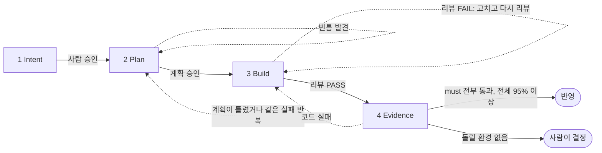

<div align="center">

# sdlc-kit

### 코딩 에이전트가 제 숙제를 스스로 채점하지 않게 합니다.

**어떤 코드베이스, 어떤 도메인에서든 쓰는 AI 코딩 에이전트용 4단계 SDLC.**

Intent → Plan → Build → Evidence. 코드를 쓰기 전에는 여러 탐색 에이전트를 나란히 돌려 조사하고, 코드를 쓴 뒤에는 따로 띄운 리뷰어가 공격적으로 검토하며, 마지막에는 점수를 매겨 다음 단계를 정합니다.

[](https://github.com/cskwork/sdlc-kit/releases/latest)
[](https://cskwork.github.io/sdlc-kit/)

[**사이트 보기**](https://cskwork.github.io/sdlc-kit/) · [**빠른 시작**](#빠른-시작) · [**계약 문서**](SKILL.md) · [**English**](README.md)

</div>

---

코드는 이제 빨리 나옵니다. **틀렸을 때 드는 비용은 여전히 큽니다.** 코드부터
쓰는 에이전트는 부작용을 가장 늦게 발견하고, 자기 작업을 자기가 검사하는
에이전트는 문제를 잘 찾지 못합니다. sdlc-kit은 이해를 맨 앞에, 독립된 증명을
맨 뒤에 두고, 그 사이는 작게 유지합니다.

[Anthropic의 AI-Native SDLC playbook](https://claude.com/blog/the-ai-native-sdlc-playbook)을
바탕으로 했고, 특정 하네스가 필요 없습니다. 핵심 루프는 Markdown 파일과 셸 스크립트
하나로 되어 있습니다. 개인 to-do는 Node 18+가 필요한 선택 기능입니다.

> sdlc-kit은 독립 프로젝트이며 Anthropic과 관계가 없습니다.

## 루프



| 단계 | 하는 일 | 되돌아가는 때 |
|---|---|---|
| **1 Intent** | 요청한 것, 에이전트가 이해한 것, 그 이해에 숨은 위험을 적고, 여섯 영역으로 명확도를 매깁니다. 90%에 못 미치면 에이전트가 코드를 살피고, 버그를 재현하고, 스펙을 조사하거나, 티켓·이슈·PR에서 요청자에게 묻습니다. 맨 위 세 줄 요약(At a glance)으로 시작하고 에이전트용 근거는 맨 아래에 둡니다. 각 제목의 뜻은 아래 표에 있습니다. 사람은 "이게 원하는 것인가?"에 답해 승인합니다. | — |
| **2 Plan** | 여러 scout가 나란히 정본·데이터·로직·사용자 흐름을 조사해 `refs/`에 남깁니다. `PLAN.md` 한 장에 AS-IS → TO-BE, 부작용, QA가 돌릴 시나리오를 담습니다. | 누락 점검에서 빈틈이 나올 때 |
| **3 Build** | 가장 작은 완전한 변경을 만들어 커밋하고, 별도 리뷰어가 공격적으로 검토합니다. | 리뷰 FAIL: 고치고 다시 리뷰 |
| **4 Evidence** | 실제 검사 뒤, 모든 시나리오를 각 페르소나로 실제 인터페이스에서 돌립니다. 점수와 다음 경로는 에이전트가 아니라 `sdlc.sh score`가 정합니다. | 계획이 틀렸거나 같은 실패 반복 → Plan, 코드 실패 → Build |

### intent.md 제목 읽는 법

제목과 항목 이름은 영어로 두고 본문은 요청한 사람의 언어로 씁니다.

| 제목·항목 | 뜻 |
|---|---|
| **At a glance** — What changes · Not included · Your call | 한눈에 보기: 끝나면 무엇이 바뀌는지, 빠지는 것 중 가장 큰 것, 사람이 정해야 할 것 |
| **What was asked** | 요청 원문 또는 충실한 발췌 |
| **Why this came up** | 요청이 생긴 배경(이력). 요청·티켓·스레드에 이유가 있으면 인용하고, 없으면 티켓 이력·연결 이슈·커밋·memory로 추정해 줄 앞에 `(추정)`과 근거를 붙입니다. 추정을 사실처럼 쓰지 않습니다. |
| **What we will do** — Included · Not included · Done when | 이번에 할 일, 하지 않을 일(이유 포함), 끝났다고 볼 기준 `O1..On`(눈으로 확인 가능) |
| **Risks** | 이 요청에 숨은 위험. ⚠️는 사람의 권한이 필요한 것 |
| **Shipping** — Ship to · Note · Allowed | 어디까지 반영할지(`local`·`pr`·`deploy`), 부가 설명, 사람이 허락했는지 |
| **Questions for you** | 답이 없으면 승인할 수 없는 질문. 답하면 `— resolved:`가 붙습니다 |
| **Key terms** | 요청을 좌우하는 용어와 그 뜻 |
| **How sure we are** — Goal · Boundaries · Today · After · Done when · Limits | 확신 정도: 목표, 범위 경계, 지금 동작, 바뀐 뒤 동작, 완료 기준, 제약을 `clear`·`assumed`·`open`으로 매기고 90%가 넘어야 승인 |
| **Facts** | 위 판단의 근거 `F1..`와 출처 |

v2.13.0까지의 제목(Bottom line, Understood as, Clarity, Delivery 등)으로 쓴 intent.md도 `sdlc.sh`가 그대로 읽습니다.

되돌아가는 횟수는 리뷰 FAIL, Plan 복귀, Build 복귀마다 세 번까지입니다. 넘으면
루프가 멈추고 사람이 정하며, `sdlc.sh approve plan --human`으로만 다시 시작합니다.
못 돌린 시나리오는 실패로 칩니다. 시나리오를 지우는 것은 사람만 할 수 있고,
PASS에는 반드시 로그가 붙어야 합니다.

## 빠른 시작

```bash
# 1. 한 번 설치하고, 에이전트가 스킬을 찾는 폴더에 연결
git clone https://github.com/cskwork/sdlc-kit ~/sdlc-kit
ln -s ~/sdlc-kit ~/.claude/skills/sdlc-kit      # Claude Code 기준, 하네스마다 스킬 폴더가 다름

# 2. 프로젝트(또는 모노레포의 배포 단위)에 씨앗 심기
cd /path/to/your-project
~/sdlc-kit/sdlc.sh init
$EDITOR .sdlc/config.md                          # build, test, lint, run, e2e, qa
```

스킬 폴더가 없는 하네스라면 지침 파일(`AGENTS.md`, `CLAUDE.md`, `GEMINI.md`)에
`For SDLC work, read ~/sdlc-kit/SKILL.md and follow it.`을 넣으세요. 그다음
"CSV 내보내기 추가", "로그인 리다이렉트 고쳐 줘"처럼 평소 말로 요청하면 에이전트가
루프를 돕니다. 다음에 할 일은 언제든 `sdlc.sh next <slug>`가 알려 줍니다.

## 기능 하나가 남기는 것

```
.sdlc/work/<slug>/
  intent.md     요청과 그 배경, 할 일, 위험, 확신 정도
  refs/         scout 결과와 intent 점검: source.md data.md logic.md flow.md learnings.md intent-check.md
  PLAN.md       한 장: 이해, AS-IS → TO-BE, 부작용, 변경, 시나리오
  review.md     리뷰 라운드, 각 라운드는 VERDICT로 끝남
  evidence.md   검사, 시나리오별 결과 한 행, 반영 기록
  logs/         모든 PASS·FAIL 뒤의 원본 출력, scripts/는 시나리오별 재실행 스크립트
```

끝난 기능은 `.sdlc/archive/`로 옮겨집니다. 검증된 사실은 `memory` 폴더로
옮기고, 다음 기능의 scout가 그 폴더부터 읽습니다. 그 안의 `glossary.md`가
프로젝트 용어집입니다. Intent는 요청의 용어를 여기에 대조하고, Evidence는 기능에서
확정한 용어를 여기에 더합니다.

## 설정

프로젝트마다 다른 값은 `.sdlc/config.md` 한 곳에만 둡니다. `build`, `test`,
`lint`, `run`, `e2e` 명령, 화면이나 API를 다룰 `qa` 도구, 선택 실행기 어댑터 `qa_runner`와
그 로그인 명령 `qa_session`, `human_gates`(기본값
`intent`, 모든 plan을 직접 승인하려면 `plan` 추가, 위험 플래그가 있는 plan은
설정과 상관없이 사람이 승인), `memory` 폴더, `repos`(리뷰가 묶을 저장소.
프로젝트 루트 아래 저장소가 많으면 나열하거나 리뷰마다 `sdlc.sh review <slug> pass --repos "<경로> ..." "<메모>"`로 지정하고, 비우면 루트 아래 전부)입니다. `.sdlc/`는
`.git/info/exclude`로 git에서 빠집니다. 팀이 배운 것을 공유하려면 `memory:`를
git이 추적하는 폴더로 지정하세요.

`adapters/e2e/`가 그런 실행기 하나입니다. `qa_runner: e2e`이면 QA는 브라우저·모바일
시나리오마다 [e2e](https://www.npmjs.com/package/e2e) 테스트를 씁니다. 결정적 층(증거,
모델 없음)과, 다음 라운드부터 모델 호출 없이 재생되는 선택 agent 층으로 나뉩니다.
키트는 e2e의 에이전트 가이드를 버전 고정으로 들고 있어(Apache-2.0) 오프라인에서도
쓸 수 있고, `adapters/e2e/update.sh [버전]`으로 갱신합니다.

## 늘 지키는 규칙

- **권한은 게이트와 별개입니다.** 데이터 유실, 마이그레이션, 공개 API 변경,
  보안에 민감한 코드, 인프라 변경, push·merge·배포, 티켓에 다는 댓글은 어떤
  설정에서든 사람이 미리 허락해야 합니다.
- **독립된 눈.** scout, 리뷰어, QA는 작업을 만든 컨텍스트가 아닌 새 컨텍스트에서
  돕니다.
- **주장 대신 증거.** 실행 환경이 없으면 PASS가 아니라 BLOCKED입니다. 버그 수정에는
  수정 전에 실패한 테스트가 있어야 하고, 새 동작의 테스트는 그 동작 없이 한 번
  실패하는 것을 확인합니다.
- **검증한 것만 반영.** 반영한 트리가 검증한 커밋과 다르면 `close`가 거부합니다.

Build는 [ponytail](https://github.com/DietrichGebert/ponytail) 방식(가장 작은
완전한 변경)을 따릅니다. 규칙은 단계 문서에 들어 있어서 다른 스킬이 필요 없습니다.

## 호스트에서 돌리기

`sdlc.sh status --json`은 모든 기능의 단계, 상태, 점수, 경로를 보여 줍니다.
`sdlc.sh next <slug>`는 `0` 진행 가능, `10` 사람 필요, `20` 막힘, `30` 완료로
끝납니다. 스크립트는 기록하고 보고할 뿐 모델을 돌리지 않습니다. 무인 실행은
기록된 사람의 허락만큼만 반영합니다. 따로 허락하지 않았다면 로컬 커밋까지입니다.
Windows에서는 Git Bash나 WSL로 `sdlc.sh`를 실행하세요.

## 개인 to-do

여러 프로젝트의 할 일을 사람이 읽을 수 있는 `~/.sdlc/todo.md` 하나에 모읍니다.
TUI와 localhost 웹 페이지는 같은 파일을 실시간으로 보여 주고 고칩니다.
다른 파일을 쓰려면 `SDLC_TODO`를 지정하세요.
이 선택 기능에는 Node 18+가 필요하고, 핵심 루프는 여전히 bash만 있으면 됩니다.

```bash
node ~/sdlc-kit/todo/todo.mjs                     # TUI와 웹 페이지
node ~/sdlc-kit/todo/todo.mjs web --open          # 웹 페이지만 열기
node ~/sdlc-kit/todo/todo.mjs add "Fix login ~/code/web https://acme.atlassian.net/browse/WEB-123" --by jira
node ~/sdlc-kit/todo/todo.mjs next                # 첫 Open 항목
node ~/sdlc-kit/todo/todo.mjs take <id> --json    # 작업자가 맡은 항목 하나와 그 답
```

TUI와 웹 페이지는 영어나 한국어로 표시합니다. `--lang ko`(TUI 또는 `web`)를 주거나 `SDLC_TODO_LANG=ko`를 지정하세요. 플래그가 우선하고, 모르는 값이면 영어, 기본값도 영어입니다.
TUI에서는 `L`, 웹 페이지에서는 언어 메뉴로 바꾸며 다시 시작하거나 새로 고칠 때까지 유지됩니다.
상태는 다음에 누가 움직일지 보여 줍니다. 내 차례(범위 승인·계획 승인·답변), 에이전트 진행 중, 답변 전달됨 — 에이전트 수신 전, 시작 전, 막힘 — 조치 필요, 완료이며, 에이전트가 멈추는 행에는 그 사실을 적습니다.
sdlc 대기에 단 답은 에이전트가 `next`나 `take`로 읽기 전까지 "답변 전달됨 — 에이전트 수신 전"으로 보이고, 읽은 뒤에는 sdlc.sh가 다음 단계로 넘어갈 때까지 다시 내 차례로 돌아옵니다.
언어를 더하려면 `todo/locales/en.mjs`를 `todo/locales/<code>.mjs`로 복사해 `name`과 모든 문구를 옮기고, `todo/i18n.mjs`의 `locales`에 import를 하나 더하세요.
플래그·TUI 키·페이지 메뉴·제공 파일은 이 목록을 따릅니다. 키나 `{placeholder}`가 빠지면 parity 테스트가 실패하고, 실행 중 빠진 키는 영어로 보입니다.

에이전트와 외부 프로그램은 `todo.mjs add`로 프로젝트 경로와 Jira 같은 티켓 링크를 붙입니다.
키트가 Jira API를 호출하지는 않습니다.
새로 만들거나 재개하는 모든 sdlc slug에는 to-do 항목이 하나씩 있습니다.
호스트가 [todo/AGENT.md](todo/AGENT.md)를 따르도록 하면 에이전트가 먼저 할 일을 처리합니다.
Claude Code `/loop`, cron/launchd, Paseo 예약 실행 예시가 들어 있고, 키트는 모델을 직접 돌리지 않습니다.

`next`의 종료 코드는 `0` 진행 가능, `10` 사람 대기, `20` 오류 문구와 함께 막힘, `30` 할 일 없음입니다.
에이전트는 첫 항목이 사람을 기다리거나 막혀 있으면 멈추고, 아래 항목으로 넘어가지 않습니다.
게이트 승인과 intent의 차단 질문은 sync에 나타나므로 에이전트는 별도 `wait` 없이 멈춥니다.
`wait`는 프로젝트 선택이나 sdlc 산출물 밖의 질문처럼 sdlc.sh가 추적하지 않는 질문에만 씁니다.
TUI, 웹 페이지, 채팅에서 결정하세요. 답은 산출물에 반영할 내용이며 승인이 아닙니다.
웹 페이지에서 intent나 plan을 읽고 승인할 수 있습니다.

끝난 항목은 체크와 취소선을 붙여 Done 맨 위로 옮깁니다.
Done에는 최근 30개를 두고, 넘치면 오래된 항목부터 같은 폴더의 `todo-archive.md`로 옮깁니다.
기록에는 로컬 시간 `YYYY-MM-DD HH:MM`, 작성자, 한 일이 남습니다.
파일을 직접 고쳐도 됩니다. 다만 편집기에 오래 열어 둔 내용을 저장하면 그사이 바뀐 내용을 덮어쓸 수 있습니다.

웹 서버는 `127.0.0.1`에만 열리고 Host/Origin을 검사합니다. 실행마다 새 토큰을 만들고 서버와 페이지의 메모리에 보관합니다.
키트는 토큰을 디스크에 쓰지 않습니다. 브라우저는 연 URL을 방문 기록에 남길 수 있으며, 프로세스가 종료되면 토큰도 효력을 잃습니다.
승인은 `sdlc.sh approve <intent|plan> <slug> --human "<words>" --sha <hex>`로 화면에 보여 준 바이트에 묶이며, 내용이 바뀌면 거부됩니다.
같은 사용자 계정으로 실행되는 프로그램은 기존 `--human`과 마찬가지로 이 보안 경계 밖에 있습니다.

## v0.x에서 올리기

v2는 새 계약입니다. 기록은 있던 자리에 그대로 남습니다.

- v0에서 시작한 기능은 `sdlc.sh status`에 `legacy`로 보입니다. 옛 kit
  (`git -C ~/sdlc-kit checkout v0.27.0`)로 마치거나
  `sdlc.sh close <slug> dropped "<이유>"`로 닫으세요.
- `lazymode`는 계속 읽힙니다. 0–1 → `human_gates: intent plan`, 2–3 → `intent`,
  4 → 없음. 직접 정하려면 `human_gates:`를 쓰세요. `intent`, `plan`이 아닌
  값은 둘 다로 처리합니다.
- v0처럼 `.sdlc/memory/`가 기본 memory 폴더입니다. 예전 `knowledge:` 줄도 폴더를
  지정하고, 지정한 폴더가 아닌 기본 폴더가 있으면 `sdlc.sh`가 알립니다.
- `init.sh` → `sdlc.sh init`, `gates/status.sh --json`과 `tools/auto.sh next` →
  `sdlc.sh status --json`과 `sdlc.sh next`(종료 코드 동일). spec.md, summary.md,
  delivery.md, qa-guide.md, map.md, harvest, 검증 영수증, handoff, tripwire,
  refcheck, QA 모드 전환은 없어졌고, 그 역할은 PLAN.md, evidence.md,
  `sdlc.sh close`, config의 `qa:`가 맡습니다.

바꾼 이유: [v2.0.0 changelog](log/changelog-v2.0.0.md).

## kit 검증

```bash
bash tests/selftest.sh
```

모든 프롬프트의 단어 예산, 게이트·라우팅 규칙, 작은 CLI fixture에서 실제 기능
하나를 4단계 끝까지 돌리는 검사가 들어 있습니다. CI는 Linux, macOS, Windows에서
돌립니다.

## 라이선스

MIT
