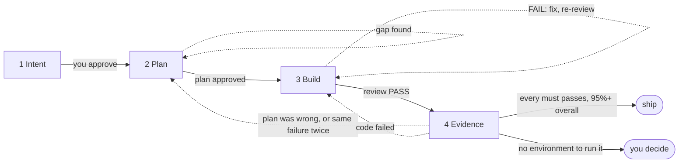
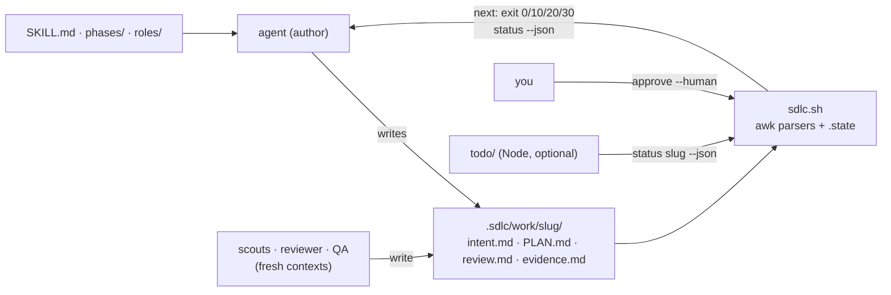

<div align="center">

# sdlc-kit

### Stop letting coding agents mark their own homework.

**A portable four-phase SDLC for AI coding agents, in any codebase and any domain.**

Intent → Plan → Build → Evidence. Parallel scouts before code, an adversarial reviewer after it, and a scored, routed proof at the end.

[](https://github.com/cskwork/sdlc-kit/releases/latest)
[](https://cskwork.github.io/sdlc-kit/)
[](#quick-start)

[**See the live site**](https://cskwork.github.io/sdlc-kit/) · [**Quick start**](#quick-start) · [**Read the contract**](SKILL.md) · [**한국어**](README.ko.md)

</div>

---

Coding is fast now. **Being wrong is still expensive.** An agent that starts by
writing code finds the side effects last, and an agent that checks its own work
finds few. sdlc-kit puts understanding first and independent proof last, and
keeps everything in between small.

It is adapted from [Anthropic's AI-Native SDLC playbook](https://claude.com/blog/the-ai-native-sdlc-playbook)
and needs no particular harness: the core loop is Markdown plus one shell script.
The personal to-do is an optional Node 18+ add-on.

> sdlc-kit is an independent project and is not affiliated with Anthropic.

## The loop



| Phase | What happens | Goes back when |
|---|---|---|
| **1 Intent** | What you asked, what the agent understood, and the risks in it, scored for clarity across six areas. Below 90% the agent explores, reproduces the bug, researches the spec or asks the requester on the ticket, issue or pull request. It reads top-down in plain words — **At a glance** (What changes, Not included, Your call), **What was asked**, **Why this came up** (marked `(inferred)` when the agent had to infer it, with its evidence), **What we will do** with its Done when criteria, **Risks**, **Shipping** and **Questions for you** — and keeps the agent's evidence (**Key terms**, **How sure we are**, **Facts**) at the bottom; you approve it by answering "is this what you want?". | — |
| **2 Plan** | Parallel scouts map source of truth, data, logic and user flow into `refs/`; one `PLAN.md` holds AS-IS → TO-BE, side effects and the scenarios QA will run. | the gap check finds holes |
| **3 Build** | The smallest complete change, committed, then a separate adversarial reviewer. | the review FAILs: fix it, review again |
| **4 Evidence** | Real checks, then every scenario as its persona through the real interface. `sdlc.sh score` scores and routes it; the agent does not judge. | the plan was wrong or the same failure came twice → Plan; code failed → Build |

Every way back is capped at three — three review FAILs, three returns to Plan,
three to Build — then the loop stops for you, and only
`sdlc.sh approve plan --human` resumes it. A scenario that could not run counts
as failed, only you can remove a scenario, and every PASS needs its log.

## How it is built

No runtime: Markdown prompts the agent reads, one Bash script that records
and routes, and an optional Node to-do. Full map:
[docs/architecture.md](docs/architecture.md).



Key decisions ([ADRs](docs/adr/)):

- **Approvals bind bytes.** `approve` stores the sha256 of `intent.md` or
  `PLAN.md` (the plan also stores the intent hash it was approved against) and
  who approved; any edit closes the gate (`gate_intent`, `gate_plan` in
  [`sdlc.sh`](sdlc.sh), [ADR 0002](docs/adr/0002-hash-bound-approvals.md)).
- **Reviewed code is shipped code.** A review PASS records every bound repo's
  HEAD; `score` and `close` refuse a different or dirty commit
  (`review_heads`, `validate_commits` in `sdlc.sh`).
- **The script routes, not the agent.** `sdlc.sh score` sends failures to Plan
  or Build, or to you, with fixed caps of three
  ([ADR 0003](docs/adr/0003-script-scores-and-routes-evidence.md)).
- **One script, four phases.** v2 replaced six stages and about 7,000 script
  lines with `sdlc.sh` (about 600 lines today)
  ([ADR 0001](docs/adr/0001-four-phases-one-script.md),
  [v2.0.0 changelog](log/changelog-v2.0.0.md)).
- **Independent eyes by contract.** Scouts, reviewer and QA are separate role
  prompts ([`roles/`](roles/)) run as subagents; this is a rule in
  [`SKILL.md`](SKILL.md), not something the script can enforce.

## Quick start

```bash
# 1. Install once, and link it where your agent finds skills
git clone https://github.com/cskwork/sdlc-kit ~/sdlc-kit
ln -s ~/sdlc-kit ~/.claude/skills/sdlc-kit      # Claude Code; use your harness's skills folder

# 2. Seed a project (or one shipping unit of a monorepo)
cd /path/to/your-project
~/sdlc-kit/sdlc.sh init
$EDITOR .sdlc/config.md                          # build, test, lint, run, e2e, qa
```

Without a skills folder, add `For SDLC work, read ~/sdlc-kit/SKILL.md and
follow it.` to the harness's instruction file (`AGENTS.md`, `CLAUDE.md`,
`GEMINI.md`). Then ask for a change in plain words — "add CSV export",
"fix the login redirect" — and the agent runs the loop. `sdlc.sh next <slug>`
always says what comes next.

## What one feature leaves behind

```
.sdlc/work/<slug>/
  intent.md     what was asked and why, what we will do, risks, and how sure we are
  refs/         scout findings and the intent check: source.md data.md logic.md flow.md learnings.md intent-check.md
  PLAN.md       one page: understanding, AS-IS → TO-BE, side effects, changes, scenarios
  review.md     reviewer rounds, each ending in VERDICT
  evidence.md   checks, one result row per scenario, shipping
  logs/         raw output behind every PASS and FAIL; scripts/ re-runs each scenario
```

Closed features move to `.sdlc/archive/`. Verified facts move to the
`memory` folder, which the next feature's scouts read first. Its
`glossary.md` holds the project's terms: Intent matches each request's terms
against it, and Evidence adds the terms a feature settled.

## Config

`.sdlc/config.md` is the only project-specific file: the `build`, `test`,
`lint`, `run` and `e2e` commands, the `qa` tool that drives screens or APIs,
an optional `qa_runner` adapter with its `qa_session` sign-in command,
`human_gates` (default `intent`; add `plan` to approve every plan yourself — a
plan with a risk flag always asks), the `memory` folder, and `repos` (the
repositories a review binds — list them when the project root holds many,
or name them per review with `sdlc.sh review <slug> pass --repos "<path> ..." "<note>"`;
empty means every one under it). `.sdlc/` stays
out of git through `.git/info/exclude`; point `memory:` at a tracked folder
to share what the team learns.

`adapters/e2e/` is one such runner: with `qa_runner: e2e`, QA writes each
browser or mobile scenario as an [e2e](https://www.npmjs.com/package/e2e)
test with a deterministic layer (the evidence, no model) and an optional
agent layer that replays without model calls on later rounds. The kit
vendors e2e's agent guide (Apache-2.0, pinned) so it works offline;
`adapters/e2e/update.sh [version]` refreshes it.

## Rules that never relax

- **Authority is not a gate.** Data loss, migrations, public API changes,
  security-sensitive code, infra changes, push, merge or deploy, and a
  comment posted on a ticket need your prior words at every setting.
- **Independent eyes.** Scouts, reviewer and QA run in fresh contexts, never
  in the one that wrote the work.
- **Proof, not claims.** No environment means BLOCKED, never PASS. A bug fix
  needs a test that failed before the fix; a test for new behavior is seen
  failing once without it.
- **Shipped means what was verified.** `close` refuses a shipped tree that
  differs from the verified commit.

Build follows the [ponytail](https://github.com/DietrichGebert/ponytail) approach — the
smallest complete change — with the rules written into the phase file, so no
other skill is needed.

## Drive it from a host

`sdlc.sh status --json` lists every feature with its phase, state, score and
route. `sdlc.sh next <slug>` exits `0` ready, `10` needs a human, `20`
blocked, `30` done. The scripts record and report; they never run a model. An
unattended run ships no further than your recorded words allow — a local
commit unless you said more. Windows: run `sdlc.sh` in Git Bash or WSL.

## Personal to-do

Keep work across projects in one human-readable `~/.sdlc/todo.md`.
The TUI and localhost web page show and update the same file live.
Set `SDLC_TODO` to use another file.
This optional add-on requires Node 18+; the core loop still needs only bash.

```bash
node ~/sdlc-kit/todo/todo.mjs                     # TUI plus web page
node ~/sdlc-kit/todo/todo.mjs web --open          # web page only
node ~/sdlc-kit/todo/todo.mjs add "Fix login ~/code/web https://acme.atlassian.net/browse/WEB-123" --by jira
node ~/sdlc-kit/todo/todo.mjs next                # first Open item
node ~/sdlc-kit/todo/todo.mjs take <id> --json    # one item a worker owns, with its replies
```

The TUI and web page show English or Korean: pass `--lang ko` (TUI or `web`) or set `SDLC_TODO_LANG=ko`; the flag wins, an unknown variable means English, and English is the default.
Press `L` in the TUI or use the page's language menu to switch until restart or reload.
Statuses say who acts next: your turn (approve intent, approve plan or answer), agent working, answered — not picked up yet, not started, blocked — fix needed, or done; the row where agents stop says so.
A reply shows "answered — no agent has picked it up yet" until an agent reads it with `next` or `take`; after an sdlc wait the item then waits for you again until sdlc.sh moves on. A worker that waits on you outside sdlc (an approval, a ticket answer) records it with `wait` and drops it with `resume`.
To add a language, copy `todo/locales/en.mjs` to `todo/locales/<code>.mjs`, translate `name` and every message, and add its import to `locales` in `todo/i18n.mjs`.
The flag, the TUI key, the page menu and the served files follow that registry; the parity test fails on a missing key or `{placeholder}`, and a missing key shows in English.

Agents and programs use `todo.mjs add` to attach a project path and ticket link, including Jira links.
The kit makes no Jira API calls.
Every sdlc slug, new or resumed, has a to-do item.
Have a host follow [todo/AGENT.md](todo/AGENT.md) to work proactively.
It includes Claude Code `/loop`, cron/launchd and Paseo recipes; the kit never runs a model.

`next` exits `0` workable, `10` waiting for the human, `20` blocked with error text, or `30` nothing to do.
Agents must stop at a waiting or blocked first item and never skip to a lower one.
Gate approvals and intent Questions for you surface through sync; the agent stops without adding an explicit wait.
Use `wait` only for questions sdlc.sh does not track, such as which project or a question outside an sdlc artifact.
Decide in the TUI, web page or chat; replies inform the artifact and never count as approval.
The web page shows intent or plan before approval.

Completed items are checked, struck through and moved to Done, newest first.
Done keeps 30 items; older ones move to `todo-archive.md` beside the to-do file.
History records local time as `YYYY-MM-DD HH:MM`, with the author and action.
You can edit the file directly; saving an old editor buffer can overwrite newer changes.

Web access stays on `127.0.0.1`, with Host/Origin checks and a per-run token held in memory by the server and page.
The kit never writes the token to disk; the browser may keep the opened URL in history. The token dies when the process exits.
Approve binds the bytes shown through `sdlc.sh approve <intent|plan> <slug> --human "<words>" --sha <hex>`; changed bytes are refused.
Same-user programs are outside this boundary, as with `--human`.

## Upgrading from v0.x

v2 is a new contract. Your records stay where they are.

- Features started under v0 show as `legacy` in `sdlc.sh status`. Finish them
  with the old kit (`git -C ~/sdlc-kit checkout v0.27.0`) or close them:
  `sdlc.sh close <slug> dropped "<reason>"`.
- `lazymode` keeps working: 0–1 → `human_gates: intent plan`, 2–3 → `intent`,
  4 → none. Write `human_gates:` to choose explicitly; a word other than
  `intent` or `plan` means both.
- `.sdlc/memory/` is the default memory folder, as in v0; a `knowledge:` line still
  names the folder, and `sdlc.sh` reports a default folder that is not it.
- `init.sh` → `sdlc.sh init`; `gates/status.sh --json` and `tools/auto.sh
  next` → `sdlc.sh status --json` and `sdlc.sh next` (same exit codes).
  spec.md, summary.md, delivery.md, qa-guide.md, map.md, harvest, verification
  receipts, handoff, tripwire, refcheck and the QA-mode switch are gone: their
  jobs live in PLAN.md, evidence.md, `sdlc.sh close` and config `qa:`.

Why: [v2.0.0 changelog](log/changelog-v2.0.0.md).

## Verify the kit

```bash
bash tests/selftest.sh
```

Word budgets for every prompt, the gate and routing rules, and one real
feature driven through all four phases on a small CLI fixture. CI runs it on
Linux, macOS and Windows. When `node` is on `PATH`, the selftest also runs the
to-do suites (`node --test tests/todo*.test.mjs`).

Last observed (2026-10-28, `bash tests/selftest.sh` in CI on ubuntu-latest):
133 selftest checks passed and the to-do suites reported 183 tests, 183
passed, 0 failed, 0 skipped. macOS also passed 133 checks; Windows passed 131 and
skipped 2 that need POSIX signals or permissions
([run 40613802450](https://github.com/cskwork/sdlc-kit/actions/runs/40613802450)).
The full selftest takes several minutes because it creates many throwaway git
repositories.

## Limitations

- Independence of the reviewer and QA depends on the harness supporting
  subagents or fresh sessions; the script records verdicts but cannot prove
  who wrote them.
- `--human` is a recorded claim, not authentication: any program running as
  the same user can call it.
- Parsing is awk over Markdown tables, so artifacts must keep the template's
  headings and columns; the script reports a malformed row instead of guessing.
- The selftest is slow (it builds many throwaway git repositories), and there
  is no shellcheck step in CI.

## License

MIT
