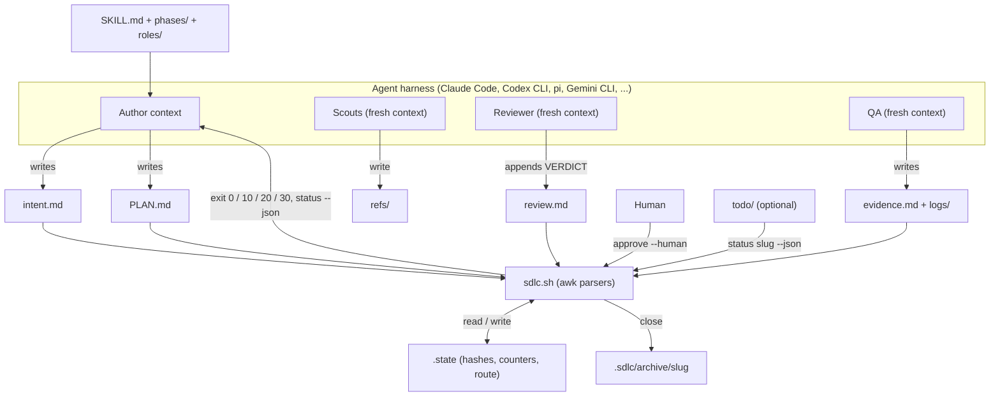

# sdlc-kit architecture

sdlc-kit has no runtime. It is a set of Markdown prompts that an agent reads,
one Bash script (`sdlc.sh`) that records approvals and decides what comes next,
and an optional Node.js to-do add-on. The script never runs a model; the agent
(or a host loop) calls it and obeys its exit codes.

## Components

| Component | Path | Role |
|---|---|---|
| Skill contract | `SKILL.md` | Entry point an agent loads. Routes a request to a phase, and lists the rules every phase follows (gates, authority, independent eyes, proof, caps). |
| Phase files | `phases/1-intent.md` … `phases/4-evidence.md` | What the agent does in each phase and which artifact it writes. |
| Role files | `roles/scout.md`, `roles/reviewer.md`, `roles/qa.md` | Prompts for subagents that run in a fresh context: read-only scouts (Plan), the adversarial reviewer (Build), and persona QA (Evidence). |
| Templates | `templates/config.md`, `intent.md`, `PLAN.md`, `evidence.md`, `ref.md` | Skeletons the script copies and later parses. |
| State machine | `sdlc.sh` | `init`, `new`, `status [--json]`, `next`, `check`, `approve`, `review`, `score`, `close`. Parses the Markdown artifacts with awk, keeps per-feature state in `.sdlc/work/<slug>/.state`, and derives phase, state and next action. |
| QA adapter (optional) | `adapters/e2e/` | Templates and a vendored agent guide for writing browser/mobile scenarios as `e2e` tests when `qa_runner: e2e`. |
| Personal to-do (optional) | `todo/todo.mjs`, `todo/core.mjs`, `todo/tui.mjs`, `todo/web.mjs`, `todo/locales/` | One Markdown to-do file (`~/.sdlc/todo.md`) shown in a TUI and a localhost web page; syncs each item's sdlc status by calling `sdlc.sh status <slug> --json`. |
| Tests | `tests/selftest.sh`, `tests/todo*.test.mjs`, `tests/fixture/` | Bash selftest of the script and prompt budgets, plus `node --test` suites for the to-do. |
| Site | `docs/index.html` | The GitHub Pages landing page (published from `main:/docs`). |

## Data flow

One feature lives in `.sdlc/work/<slug>/`. The agent writes the artifacts;
`sdlc.sh` only reads them, validates their structure, and records events in
`.state`:

1. **Intent.** `sdlc.sh new <slug>` copies `templates/intent.md`. The parser
   scores the "How sure we are" table (six areas, `clear` = 2, `assumed` = 1)
   and refuses approval below 90% or while "Questions for you" are open.
   `approve intent` stores `sha256(intent.md)`, who approved (`human` or
   `agent`), a sequence number, a timestamp and the note.
2. **Plan.** `approve plan` stores `sha256(PLAN.md)` together with the
   `intent.md` hash it was approved against. The parser requires a `Risk
   flags:` line, at least one scenario, a must scenario for every `O<n>`
   outcome, and at most 150 lines. A risk flag forces `--human`.
3. **Build.** `review <slug> pass|fail` accepts only a new `VERDICT:` round in
   `review.md` that matches the argument. A PASS records the HEAD of every bound
   git repository (or HEAD + tree with `--uncommitted`). Three FAILs stop the
   loop.
4. **Evidence.** `score` checks that every planned and previously scored
   scenario has a row, every PASS/FAIL has a non-empty log inside the feature
   folder, and the `Commit:` lines equal the reviewed HEADs with a clean tree.
   It then routes: plan-caused failure or a repeated code failure → Plan;
   every must PASS and ≥ 95% overall → deliver; a blocked must or only blocked
   rows → human; otherwise → Build.
5. **Close.** `close <slug> shipped` re-checks every gate, requires a deliver
   route on the current evidence, refuses a `Shipped:` tree that differs from
   the verified `Commit:`, and for `pr`/`deploy` requires `Authorized: yes` and
   a commit present on a remote. The folder moves to `.sdlc/archive/`.

`status --json` and `next` share one function, `derive`, which walks these
checks in order and returns the first thing that is missing as the next action.

## External dependencies

- **Core loop:** Bash, awk, git, and one of `sha256sum`, `shasum` or `openssl`
  (`sha()` in `sdlc.sh` tries them in that order). On Windows, Git Bash or WSL.
- **To-do add-on:** Node.js 18+, standard library only (no `package.json`).
- **QA adapter:** the `e2e` npm package, pinned by `adapters/e2e/VERSION`, only
  when a project opts in.
- **Agent harness:** any that can read a skill folder or an instruction file
  (`AGENTS.md`, `CLAUDE.md`, `GEMINI.md`) and spawn subagents.

## Failure handling

- **Fail closed.** An unknown `human_gates` word means both gates need a human;
  a missing artifact, unfilled template placeholder, malformed table row or
  wrong cell count is reported by name and blocks the step.
- **Stale approvals.** Editing `intent.md` closes the intent gate and every gate
  after it; editing `PLAN.md` closes the plan gate. `approve --sha <hex>` refuses
  bytes other than the ones the human was shown (used by the to-do web page).
- **Caps.** Three review FAILs, three returns to Plan, or three returns to
  Build route to the human; only `approve plan --human` resumes.
- **Atomic writes.** `.state` is written to a temp file and renamed
  (`save_state`); the to-do serializes writes through a lock file (`mutate` in
  `todo/core.mjs`) and refuses a change against an outdated item version.
- **Exit codes.** `next` exits `0` ready, `10` needs a human, `20` blocked,
  `30` done; usage errors exit `2`. Hosts branch on these instead of parsing
  text.
- **To-do web boundary.** Binds `127.0.0.1` only, checks `Host`/`Origin`, and
  requires a per-run token held in memory (`todo/web.mjs`).

## Decisions

The reasoning behind the main design choices is in the ADRs: [0001 four phases, one script](adr/0001-four-phases-one-script.md),
[0002 hash-bound approvals](adr/0002-hash-bound-approvals.md) and
[0003 the script scores and routes evidence](adr/0003-script-scores-and-routes-evidence.md).
